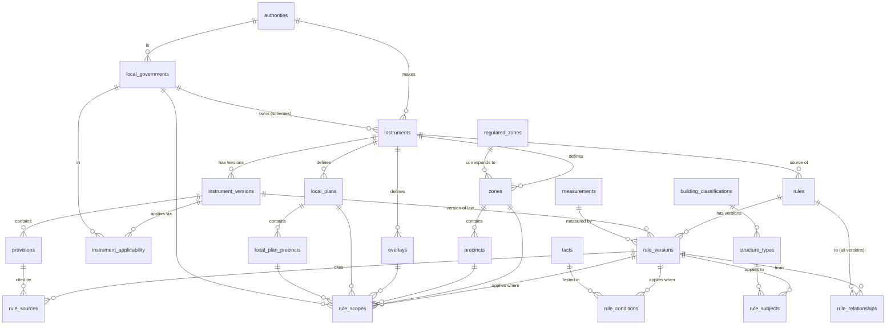

# Database plan — tables and relationships

> Generated by `npm run schema-doc` (server-ts/src/tools/schema-doc.ts) from the live database (schema `regs`). Do not edit by hand: re-run it after any schema change.

## Where the data is

* Database **`siteora`**, schema **`regs`** (26 tables, 7 views). The `public` schema is intentionally empty.
* In pgAdmin / DBeaver: `siteora → Schemas → regs → Tables`. `search_path` is set to `regs, public`, so plain `SELECT * FROM zones` works after reconnecting.
* Load or reload everything: `psql -h localhost -U postgres -d siteora -c "DROP SCHEMA IF EXISTS regs CASCADE"` then `psql -h localhost -U postgres -d siteora -v ON_ERROR_STOP=1 -f db/load_all.sql`.
* Verify: `npm run verify-load` (research files → tables, record by record) and `npm run check` (integrity + worked examples).

## Relationships

Every arrow is a foreign key in the database, so a row cannot point at something that does not exist.

## How the research files map to tables

| Field in `research/councils/<council>.json` | Stored in |
|---|---|
| `planning_scheme` (name, version, version_commenced, official_urls) | `instruments` (kind PLANNING_SCHEME) + `instrument_versions` + `instrument_applicability` (regime PLANNING) |
| `qdc_qhc_relationship.quotes[]` | `provisions` (kind APPLICATION, ref_label `QDC relationship: …`) |
| `definitions[]` | `provisions` (kind DEFINITION, ref_label `def <term>`) |
| `levels_of_assessment[]` | `provisions` (kind LEVEL_OF_ASSESSMENT, ref_label `LOA …`) |
| `overlays_affecting_siting[]` | `overlays` + `provisions` (ref_label `overlay …`) |
| `rules[]` → verbatim text, clause, page, URL, verification | `provisions` (one row per rule, `research_key` = `rule_key`) |
| `rules[]` (except provision_type DEFINITION) → the rule | `rules` + `rule_versions` (status DRAFT, or SUPERSEDED once curated) + `rule_scopes` + `rule_subjects` + `rule_sources` |
| `rules[].zones` | `rule_scopes`, mapped through `research/places.json` → zones / precincts / local plans |
| `rules[].alternative_provision_to_qdc_qhc = YES` | `rule_relationships` type OVERRIDES → the matching QDC rules |
| `open_questions[]` | `open_issues` |
| `fetch_log[]` | not loaded (kept in the JSON as research provenance) |

Curated rules (`db/031` to `db/036`) are hand-encoded from the same provisions. Each one `REPLACES` its draft,
which then shows status SUPERSEDED.

## Tables

### Sources — where the law comes from

#### `authorities` — 11 rows

Bodies that make the law: Parliament, State Government, ABCB, Standards Australia, the 7 councils.

*Loaded by:* db/010

| Column | Type | Null | Key / references |
|---|---|---|---|
| `authority_id` | text | no | **PK** |
| `name` | text | no |  |
| `authority_type` | text | no |  |
| `website` | text | yes |  |

#### `local_governments` — 7 rows

The councils in scope.

*Loaded by:* db/010

| Column | Type | Null | Key / references |
|---|---|---|---|
| `lg_id` | text | no | **PK** |
| `authority_id` | text | no | → `authorities.authority_id` |
| `official_name` | text | no |  |
| `former_names` | text[] | no |  |
| `abs_lga_code` | text | yes |  |
| `notes` | text | yes |  |

#### `instruments` — 20 rows

A legal document: Act, Regulation, QDC part, planning scheme, Australian Standard.

*Loaded by:* db/010 (state), db/030 (planning schemes)

| Column | Type | Null | Key / references |
|---|---|---|---|
| `instrument_id` | text | no | **PK** |
| `authority_id` | text | no | → `authorities.authority_id` |
| `lg_id` | text | yes | → `local_governments.lg_id` |
| `kind` | instrument_kind | no |  |
| `force` | legal_force | no |  |
| `title` | text | no |  |
| `short_title` | text | yes |  |
| `citation` | text | yes |  |
| `notes` | text | yes |  |

#### `instrument_versions` — 19 rows

One published version / reprint of a document, with dates, URL, archived file and SHA-256.

*Loaded by:* db/010, db/030

| Column | Type | Null | Key / references |
|---|---|---|---|
| `instrument_version_id` | text | no | **PK** |
| `instrument_id` | text | no | → `instruments.instrument_id` |
| `version_label` | text | no |  |
| `published_date` | date | yes |  |
| `effective_from` | date | yes |  |
| `effective_to` | date | yes |  |
| `superseded_by` | text | yes | → `instrument_versions.instrument_version_id` |
| `status` | record_status | no |  |
| `source_url` | text | yes |  |
| `local_file` | text | yes |  |
| `file_sha256` | text | yes |  |
| `retrieved_at` | timestamp with time zone | yes |  |
| `verified_at` | timestamp with time zone | yes |  |
| `verified_by` | text | yes |  |
| `notes` | text | yes |  |

#### `provisions` — 790 rows

One clause, table row or figure with its exact words (verbatim_text). Council provisions carry research_key = the record in research/councils/*.json they came from.

*Loaded by:* db/020 (state), db/030 (council)

| Column | Type | Null | Key / references |
|---|---|---|---|
| `provision_id` | bigint | no | **PK** |
| `instrument_version_id` | text | no | → `instrument_versions.instrument_version_id` |
| `parent_id` | bigint | yes | → `provisions.provision_id` |
| `kind` | provision_kind | no |  |
| `ref_label` | text | no |  |
| `code_name` | text | yes |  |
| `section` | text | yes |  |
| `clause` | text | yes |  |
| `subclause` | text | yes |  |
| `table_ref` | text | yes |  |
| `figure_ref` | text | yes |  |
| `page_label` | text | yes |  |
| `pdf_page` | integer | yes |  |
| `url_anchor` | text | yes |  |
| `verbatim_text` | text | yes |  |
| `verification` | verification_status | no |  |
| `research_key` | text | yes |  |
| `notes` | text | yes |  |

#### `instrument_applicability` — 32 rows

Which document version applies to which council, for which regime, between which dates (this is where the QHC transition is recorded).

*Loaded by:* db/021, db/030

| Column | Type | Null | Key / references |
|---|---|---|---|
| `applicability_id` | bigint | no | **PK** |
| `instrument_version_id` | text | no | → `instrument_versions.instrument_version_id` |
| `lg_id` | text | yes | → `local_governments.lg_id` |
| `regime` | regulatory_regime | no |  |
| `effective_from` | date | no |  |
| `effective_to` | date | yes |  |
| `end_condition` | text | yes |  |
| `basis_provision_id` | bigint | yes | → `provisions.provision_id` |
| `confidence` | verification_status | no |  |
| `notes` | text | yes |  |

### Places — where rules apply

#### `regulated_zones` — 41 rows

The 41 zones a planning scheme may use (Planning Regulation 2017 s6, sch 2).

*Loaded by:* db/020

| Column | Type | Null | Key / references |
|---|---|---|---|
| `regulated_zone_id` | text | no | **PK** |
| `name` | text | no |  |
| `category` | text | no |  |
| `source_provision_id` | bigint | yes | → `provisions.provision_id` |

#### `zones` — 56 rows

Each council scheme's zones, linked to the regulated zone, with whether a dwelling house is a permitted use.

*Loaded by:* research/places.json via db/030

| Column | Type | Null | Key / references |
|---|---|---|---|
| `zone_id` | text | no | **PK** |
| `instrument_id` | text | no | → `instruments.instrument_id` |
| `zone_code` | text | no |  |
| `name` | text | no |  |
| `regulated_zone_id` | text | yes | → `regulated_zones.regulated_zone_id` |
| `zone_code_provision_id` | bigint | yes | → `provisions.provision_id` |
| `dwelling_house_permitted` | boolean | yes |  |
| `dwelling_house_basis` | text | yes |  |
| `valid_from_version` | text | yes | → `instrument_versions.instrument_version_id` |
| `valid_to_version` | text | yes | → `instrument_versions.instrument_version_id` |
| `notes` | text | yes |  |

#### `precincts` — 40 rows

Precincts inside a zone.

*Loaded by:* research/places.json via db/030

| Column | Type | Null | Key / references |
|---|---|---|---|
| `precinct_id` | text | no | **PK** |
| `zone_id` | text | no | → `zones.zone_id` |
| `name` | text | no |  |
| `notes` | text | yes |  |

#### `overlays` — 46 rows

Overlays (flood, character, ridges, canals…).

*Loaded by:* research/councils/*.json via db/030

| Column | Type | Null | Key / references |
|---|---|---|---|
| `overlay_id` | text | no | **PK** |
| `instrument_id` | text | no | → `instruments.instrument_id` |
| `name` | text | no |  |
| `sub_category` | text | yes |  |
| `overlay_code_provision_id` | bigint | yes | → `provisions.provision_id` |
| `is_relevant_overlay` | boolean | yes |  |
| `notes` | text | yes |  |

#### `local_plans` — 7 rows

Neighbourhood / local plans.

*Loaded by:* research/places.json via db/030

| Column | Type | Null | Key / references |
|---|---|---|---|
| `local_plan_id` | text | no | **PK** |
| `instrument_id` | text | no | → `instruments.instrument_id` |
| `name` | text | no |  |
| `plan_type` | text | no |  |
| `code_provision_id` | bigint | yes | → `provisions.provision_id` |
| `notes` | text | yes |  |

#### `local_plan_precincts` — 5 rows

Precincts inside a local plan.

*Loaded by:* research/places.json via db/030

| Column | Type | Null | Key / references |
|---|---|---|---|
| `local_plan_precinct_id` | text | no | **PK** |
| `local_plan_id` | text | no | → `local_plans.local_plan_id` |
| `name` | text | no |  |
| `notes` | text | yes |  |

### Vocabulary — what rules can talk about

#### `building_classifications` — 4 rows

NCC building classes (1a, 2, 10a, 10b).

*Loaded by:* db/010

| Column | Type | Null | Key / references |
|---|---|---|---|
| `ncc_class` | text | no | **PK** |
| `description` | text | no |  |
| `source_provision_id` | bigint | yes | → `provisions.provision_id` |

#### `structure_types` — 28 rows

Tree of things a rule can target (ANY → CLASS_10A → SHED; POOL → POOL_INGROUND …).

*Loaded by:* db/010

| Column | Type | Null | Key / references |
|---|---|---|---|
| `structure_type_id` | text | no | **PK** |
| `parent_id` | text | yes | → `structure_types.structure_type_id` |
| `name` | text | no |  |
| `ncc_class` | text | yes | → `building_classifications.ncc_class` |
| `is_building` | boolean | no |  |
| `notes` | text | yes |  |

#### `structure_type_terms` — 0 rows

A document's own words mapped to the structure tree (not yet populated).

*Loaded by:* —

| Column | Type | Null | Key / references |
|---|---|---|---|
| `term_id` | bigint | no | **PK** |
| `instrument_id` | text | no | → `instruments.instrument_id` |
| `term` | text | no |  |
| `structure_type_id` | text | no | → `structure_types.structure_type_id` |
| `match_condition` | jsonb | yes |  |
| `definition_provision_id` | bigint | yes | → `provisions.provision_id` |
| `notes` | text | yes |  |

#### `facts` — 92 rows

The only inputs a rule may use (lot area, wall height, boundary type…), with type, unit and how to derive them.

*Loaded by:* db/010, db/031, db/032

| Column | Type | Null | Key / references |
|---|---|---|---|
| `fact_id` | text | no | **PK** |
| `type` | fact_type | no |  |
| `unit` | text | yes |  |
| `allowed_values` | text[] | yes |  |
| `source` | fact_source | no |  |
| `description` | text | no |  |
| `derivation` | text | yes |  |
| `definition_provision_id` | bigint | yes | → `provisions.provision_id` |

#### `measurements` — 47 rows

What a numeric requirement is measured on: from where, to where, how.

*Loaded by:* db/010, db/031, db/032

| Column | Type | Null | Key / references |
|---|---|---|---|
| `measurement_id` | text | no | **PK** |
| `measurement_type` | text | no |  |
| `subject_geometry` | text | no |  |
| `reference_geometry` | text | yes |  |
| `boundary_selector` | text | yes |  |
| `vertical_projection` | boolean | no |  |
| `evaluate_per_part` | boolean | no |  |
| `postgis_hint` | text | yes |  |
| `definition_provision_id` | bigint | yes | → `provisions.provision_id` |
| `notes` | text | yes |  |

### Rules — the regulatory content

#### `rules` — 587 rows

Stable identity of a rule across versions (id, document, topic, title).

*Loaded by:* db/021, db/030, db/031, db/032

| Column | Type | Null | Key / references |
|---|---|---|---|
| `rule_id` | text | no | **PK** |
| `instrument_id` | text | no | → `instruments.instrument_id` |
| `topic` | text | no |  |
| `title` | text | no |  |
| `notes` | text | yes |  |

#### `rule_versions` — 587 rows

The rule content for one period: role, regime, enforceability, measurement, operator, value/formula (value_expr), unit, consequence of failure, dates, status (DRAFT/ACTIVE/SUPERSEDED), verification, automatable.

*Loaded by:* same

| Column | Type | Null | Key / references |
|---|---|---|---|
| `rule_version_id` | text | no | **PK** |
| `rule_id` | text | no | → `rules.rule_id` |
| `instrument_version_id` | text | no | → `instrument_versions.instrument_version_id` |
| `role` | rule_role | no |  |
| `regime` | regulatory_regime | no |  |
| `enforceability` | enforceability | no |  |
| `provision_kind` | provision_kind | no |  |
| `measurement_id` | text | yes | → `measurements.measurement_id` |
| `operator` | comparison_op | yes |  |
| `value_expr` | jsonb | yes |  |
| `unit` | text | yes |  |
| `permits_btb` | boolean | no |  |
| `on_noncompliance` | noncompliance_outcome | yes |  |
| `effective_from` | date | no |  |
| `effective_to` | date | yes |  |
| `status` | record_status | no |  |
| `verification` | verification_status | no |  |
| `automatable` | boolean | no |  |
| `interpretation_notes` | text | yes |  |
| `created_at` | timestamp with time zone | no |  |

#### `rule_scopes` — 1,894 rows

Where a rule applies: council, zone, precinct, local plan, overlay (include or exclude).

*Loaded by:* same

| Column | Type | Null | Key / references |
|---|---|---|---|
| `rule_version_id` | text | no | → `rule_versions.rule_version_id` |
| `level` | scope_level | no |  |
| `lg_id` | text | yes | → `local_governments.lg_id` |
| `zone_id` | text | yes | → `zones.zone_id` |
| `precinct_id` | text | yes | → `precincts.precinct_id` |
| `overlay_id` | text | yes | → `overlays.overlay_id` |
| `local_plan_id` | text | yes | → `local_plans.local_plan_id` |
| `local_plan_precinct_id` | text | yes | → `local_plan_precincts.local_plan_precinct_id` |
| `exclude` | boolean | no |  |

#### `rule_subjects` — 928 rows

Which structure types a rule applies to (include or exclude).

*Loaded by:* same

| Column | Type | Null | Key / references |
|---|---|---|---|
| `rule_version_id` | text | no | **PK** → `rule_versions.rule_version_id` |
| `structure_type_id` | text | no | **PK** → `structure_types.structure_type_id` |
| `exclude` | boolean | no |  |

#### `rule_conditions` — 490 rows

When a rule applies, e.g. lot_area_m2 >= 450. Rows with the same group_no are AND-ed; groups are OR-ed.

*Loaded by:* same

| Column | Type | Null | Key / references |
|---|---|---|---|
| `condition_id` | bigint | no | **PK** |
| `rule_version_id` | text | no | → `rule_versions.rule_version_id` |
| `group_no` | integer | no |  |
| `fact_id` | text | no | → `facts.fact_id` |
| `operator` | comparison_op | no |  |
| `value` | jsonb | yes |  |
| `unit` | text | yes |  |
| `source_provision_id` | bigint | yes | → `provisions.provision_id` |
| `notes` | text | yes |  |

#### `rule_sources` — 625 rows

Why: the provision(s) a rule relies on, with the exact quote. Every active rule has a PRIMARY source.

*Loaded by:* same

| Column | Type | Null | Key / references |
|---|---|---|---|
| `rule_version_id` | text | no | **PK** → `rule_versions.rule_version_id` |
| `provision_id` | bigint | no | **PK** → `provisions.provision_id` |
| `role` | text | no | **PK** |
| `quote` | text | yes |  |

#### `rule_relationships` — 726 rows

Precedence between rules: OVERRIDES, REPLACES, EXEMPTS, RELAXES, SUPPLEMENTS, ALTERNATIVE_TO, CONDITIONAL_ON, FALLS_BACK_TO, UNRESOLVED, each with its legal basis.

*Loaded by:* same

| Column | Type | Null | Key / references |
|---|---|---|---|
| `relationship_id` | bigint | no | **PK** |
| `from_rule_version_id` | text | no | → `rule_versions.rule_version_id` |
| `to_rule_version_id` | text | yes | → `rule_versions.rule_version_id` |
| `to_rule_id` | text | yes | → `rules.rule_id` |
| `type` | relationship_type | no |  |
| `modification` | jsonb | yes |  |
| `condition_expr` | jsonb | yes |  |
| `basis_provision_id` | bigint | yes | → `provisions.provision_id` |
| `verification` | verification_status | no |  |
| `notes` | text | yes |  |

### Quality

#### `verification_log` — 0 rows

Who checked which rule/provision, when, how (not yet populated).

*Loaded by:* —

| Column | Type | Null | Key / references |
|---|---|---|---|
| `log_id` | bigint | no | **PK** |
| `rule_version_id` | text | yes | → `rule_versions.rule_version_id` |
| `provision_id` | bigint | yes | → `provisions.provision_id` |
| `checked_at` | timestamp with time zone | no |  |
| `checked_by` | text | no |  |
| `method` | text | no |  |
| `result` | verification_status | no |  |
| `notes` | text | yes |  |

#### `open_issues` — 123 rows

Known gaps and questions that block automation (incl. each research file's open_questions).

*Loaded by:* db/021, db/030

| Column | Type | Null | Key / references |
|---|---|---|---|
| `issue_id` | bigint | no | **PK** |
| `lg_id` | text | yes | → `local_governments.lg_id` |
| `instrument_id` | text | yes | → `instruments.instrument_id` |
| `rule_id` | text | yes | → `rules.rule_id` |
| `severity` | text | no |  |
| `description` | text | no |  |
| `raised_at` | date | no |  |
| `resolved_at` | date | yes |  |

## Views

| View | Shows |
|---|---|
| `v_rule_catalogue` | One readable row per rule version: topic, value, unit, primary clause, document, version, status |
| `v_active_rules` | Only the rules the engine uses (status ACTIVE) |
| `v_setback_rules`, `v_height_rules`, `v_site_coverage_rules`, `v_pool_rules` | Typed lists filtered from the catalogue |
| `v_rule_exceptions` | Every exemption / relaxation and the rule it affects |
| `v_untraceable_rules` | Rules with no PRIMARY source — must always be empty |
